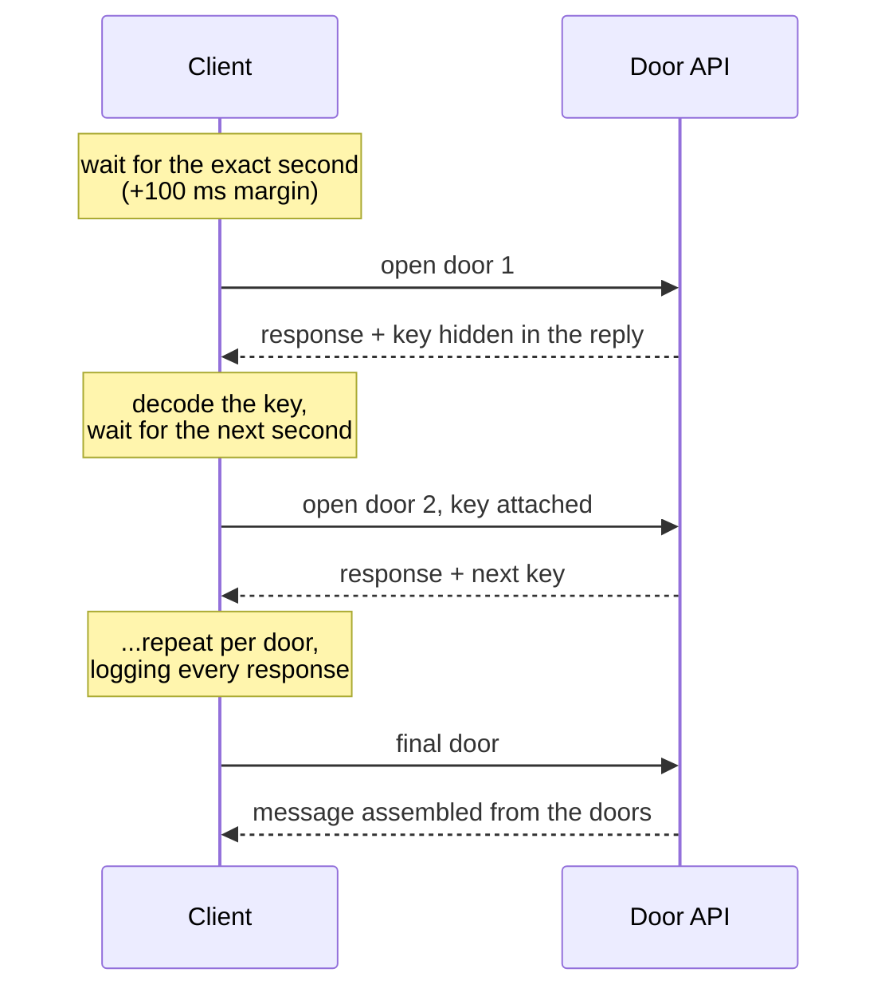

# AltScore Makers Challenge

*AltScore's hiring challenge: nine programming puzzles against a live API, where a full score leads to an
interview with the CTO. The challenge is still open, so this page shows how I approached each problem,
not the answers. Code available on request.*

## Result

- **8 of 9 challenges solved**, enough to qualify for the CTO interview. Hiring for the role closed
  before the interview took place.
- **About one day of work, 5-8 hours.** The saved results of the first challenges are timestamped within a
  single morning; the last two were finished the next day.

## How I worked

Spec-first, with Claude Code as the implementer. For each challenge I read the brief, worked out the
problem and the plan myself (what the API really returns, what the trick is, what has to be computed),
and then had the agent write the code from that plan. When an attempt failed, I went back to the
evidence: raw responses, headers, page markup, timing. Only then did I change the plan.

The challenges reward exactly that split: most of them are not hard to code, but easy to misread.

## The challenges

| # | Challenge | What it tested | How I approached it |
|---|---|---|---|
| 1 | The silent probe | A flaky sensor API | Retry until a valid reading, parse values out of strings with units, compute and submit |
| 2 | The Kepler-452b enigma | Paginated data whose order matters | Walk every page with the right sort, inspect headers for hints, de-duplicate across pages before aggregating |
| 3 | The lost Sith temple | Joining two sources | Combine a public API (SWAPI) with the challenge's "oracle", whose answers arrive encoded; decode, classify and build a per-planet index |
| 4 | The forgotten elven forge | A login riddle | Read the full server response instead of the rendered page; the clues were not where the text pointed |
| 5 | The Valiant's last stand | Decisions under a turn limit | Parse an encoded 8x8 radar, track how it changes between readings, fire once |
| 6 | Infiltrating Prisma City | Bulk aggregation over a public API | Hundreds of PokeAPI requests, averages per type, with the precision the checker expects |
| 7 | The drifting ship | Building to someone else's contract | A small Flask API with exactly the JSON, HTML markup and status codes the evaluator calls, deployed on Render |
| 8 | The magic door spell | Timing and hidden state | A sequence of requests that only open at precise seconds, each door handing the key for the next |
| 9 | Year 2315, corrupted data | Recovering a model from bad notes | Rebuild two linear relations from a corrupted engineering notebook and serve them as an API |

### The one worth drawing: challenge 8

Each door only answered correctly when hit at a specific second of the minute, and each one handed back,
somewhere in its response, what the next door needed. The client had to wait to the exact second
(with a small margin so it never landed on the boundary), carry state between calls, and keep a log of
every response to find where the next key was hidden.

## What it shows

- Reading an unfamiliar API from its responses, not from its documentation.
- Keeping the human on the reasoning and the model on the typing: the plan was mine, the code came from it.
- Delivering small services end to end: from someone else's contract to a deployed API.
