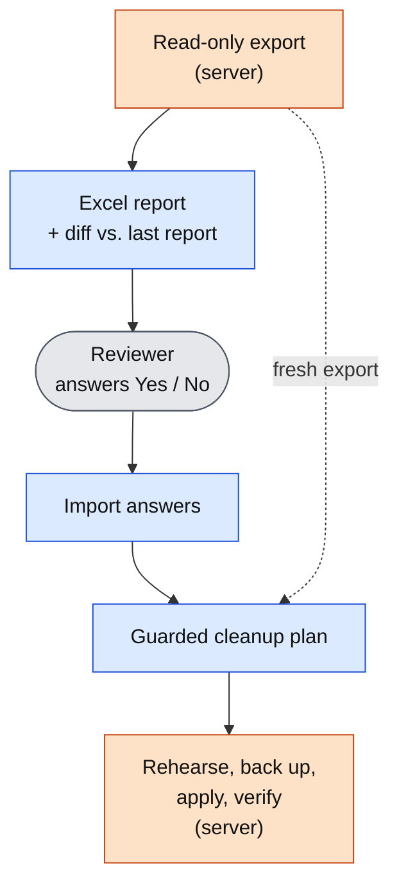

# Auditing users and permissions in a legacy ERP

*Built for Kalapata, a holding company in Mexico. The code is private; this page describes the role,
the decisions and the architecture.*

## The problem

The holding runs Aspel SAE (sales, inventory, invoicing) and Aspel BANCO (treasury) for its companies,
alongside the Odoo rollout. Aspel keeps every user, role and per-user permission for both systems in one
Firebird database, but it has no screen that shows them together: answering "who can do what, where"
means opening each user in each company, by hand.

That gap is a real risk in finance software. Users who left keep their access, people end up as
ADMINISTRADOR in companies where they should have a limited role, and permissions granted "just this
once" never go away.

There is no API, no documentation of the schema, and the server is a Windows host reached only through
Remote Desktop.

## What I built

A review cycle that turns a manual audit into three steps:

1. **Report.** A read-only export from the server becomes an Excel workbook: who has access to which
   company and with which role, who is ADMINISTRADOR where they probably should not be, and who holds
   permissions beyond their role. Follow-up reports show only what changed and carry over earlier answers.
2. **Review.** The reviewer answers Yes / No in the workbook: does this person still work here, should they
   keep these extra permissions.
3. **Apply.** The "No" answers become a guarded cleanup that runs on the server, with a rehearsal, a
   verified backup and checks that make a stale plan write nothing.

Orange runs on the Aspel server, blue on my workstation, gray is a person.

## Key decisions

**Map the schema with experiments, not guesses.** Nothing about Aspel's internal tables is documented.
I mapped them with diagnostic scripts and then with before/after dumps of every table around each action
in the UI (create, edit, delete a test user). Every statement in the schema notes is marked *verified* or
*inferred*. Two findings shaped the design:
- Editing a user in the UI **renumbers** its user-company rows, so that id cannot be a key. Everything
  matches rows by natural keys (user, system, company, action).
- In BANCO, the first companies assigned to a new user are written as **ADMINISTRADOR**, whatever role was
  picked. That explained a pattern in the data, became a check in the report, and a safe procedure for
  whoever creates users.

**Leave nothing on the server.** The scripts run from the Remote Desktop shared folder, work in a private
temp folder and copy results back. The server needs only what Aspel already installed: PowerShell 5.1
and Firebird's own `isql`. The database password is asked at run time and never written to disk or
passed on a command line. Every query in the export runs inside a read-only transaction.

**Make the only write path hard to misuse.** The cleanup is a single atomic block on Firebird 2.5:
- Before touching a user it checks the name still maps to the same id; after each delete it compares the
  affected rows with the count in the export. Any difference raises an error and Firebird undoes the whole
  block, so a plan built from an old export cannot half-apply.
- It runs once as a **rehearsal** and rolls back; only then asks for confirmation.
- It takes a **backup** and proves it restores before writing.
- It uses `NO WAIT` locking: if someone has a row open in Aspel, it fails at once instead of hanging.
- A read-only **verification** runs after the commit.

These behaviors were measured on Firebird 2.5, not assumed. For example, a custom error message can only be
raised through a cast and survives 52 characters, so messages carry a step number and the counts instead
of prose.

**Keep real data out of git.** Exports, reports, answers and backups never enter the repository. A small
fictitious export lets anyone run the whole cycle without Aspel, and the tests use it.

## Engineering

- **Stack:** PowerShell 5.1 on the server, Python on the workstation (`openpyxl` for the workbooks),
  Firebird 2.5 SQL.
- **Tests:** end to end on the fictitious export (report, carried-over answers, change sheet, cleanup plan
  and its guards), plus the generated SQL against a real Firebird 2.5 in Docker: rehearsal, stale plan,
  apply and verify, lock conflict.
- **CI:** GitHub Actions with pytest, ruff and PSScriptAnalyzer, including the Firebird container.
- **Operations:** a runbook for the full cycle and an acceptance test to run per installation (and after
  each Aspel update) on a throwaway user, to confirm how Aspel itself reacts before touching real users.

## Result

The first report has been delivered and is with the reviewer. The cleanup runs once the answers come back;
until then nothing has been written to Aspel, by design.

The acceptance test passed on SAE 8.00.37 with a throwaway user: removing extra permissions makes the user
fall back to their role, and deleting that user leaves nothing Aspel still expects. Real users are a
different case, because they have transaction history: Aspel reuses the highest user ids for the next user
created, so deleting real users is held back until it is clear how their history behaves. Permission
cleanups do not have that problem and can go first.

## How I used AI

I worked spec-first with Claude Code. I defined each step, the safety rules and what had to be proven
before the design could rely on it; the agent wrote the scripts, the tests and the SQL from that spec.
The rule that kept it honest: no statement about Aspel or Firebird entered the design until a real run
confirmed it. That is why the schema notes separate *verified* from *inferred*, and why the cleanup's
guarantees come with a test against a real Firebird server.

## My role

Sole developer: discovery on the server, schema mapping, design, implementation, tests, CI and the runbook.
