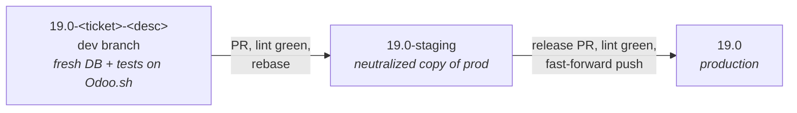

# Engineering standards for a holding's Odoo rollout

*Built for Kalapata, a holding company in Mexico. The repositories are private; this page describes the
role, the decisions and the architecture.*

## The situation

The holding runs Odoo 19 Enterprise on Odoo.sh, one multi-company database for all its companies. When I
started, the repository was almost empty: three loosely named branches, no protection, no conventions,
and an external implementation partner about to join. There was no custom code yet, which made it the
cheapest moment to decide how code gets in, gets tested and reaches production.

## Branches and releases

- **Odoo.sh is the runbot.** Every push to a dev branch builds a fresh database and runs the module
  tests; staging runs on a neutralized copy of production. So there is no custom Docker image and no
  build or test job in GitHub Actions: only lint runs there. Duplicating what Odoo.sh already does would
  be cost without coverage.
- **One repository, no fork.** Odoo.sh only builds branches of the connected repo, so dev branches live
  there and the protection goes on the main branches instead.
- **Linear history, rebase only.** Merge commits are disabled.
- **Releases by fast-forward, not by GitHub's button.** "Rebase and merge" always rewrites commits, so
  production would carry different SHAs than staging for the same code. A release is a PR from staging to
  production (to run lint) followed by a fast-forward push; GitHub then marks the PR as merged on its own.

Re-shaping the branches on Odoo.sh had its own lesson: a database does not travel with its branch. Moving
the new production branch into the Production stage started it on an empty database, so production and
staging were restored from Odoo.sh's backups, after checking each backup's description, since automatic
"before restore" backups sit in the same list. The order also matters: Production has to be set first,
or Odoo.sh pulls branches out of Staging.

## Rulesets shaped by GitHub's real limits

The plan was one ruleset per branch with a bypass for whoever releases. GitHub does not allow that as
designed: a bypass can only name roles, teams or apps, never a single user, and it exempts the actor from
every rule in that ruleset. So the protection was split in three:

| Ruleset | Branches | Rules | Bypass |
|---|---|---|---|
| Protected branches | production, staging | no deletion, no force push, linear history | none |
| Staging: PR + lint | staging | PR required (rebase only), `lint` check, branch up to date | none: a bypass would allow merging with lint red |
| Production: PR + lint | production | same | organization admins, only so the release fast-forward can land |

Each rule was tested, not assumed: probe branches were added to the rulesets temporarily to confirm that
a direct push, a force push and a deletion are rejected, that a PR without `lint` stays blocked, and that
the owner's fast-forward release still passes. The probes were removed afterwards.

The organization itself was hardened before any of this: 2FA required, no base permissions, members
cannot create, fork or delete repositories, and Actions limited to GitHub and verified creators with a
read-only token.

## Lint as the gate

- **pre-commit, derived from Vauxoo's templates** (LGPL notice kept on what was adapted), rendered once
  for Odoo 19 / Python 3.12 and versioned in the repo: ruff with Odoo rules, pylint-odoo, OCA module and
  translation checks (blocking, where Vauxoo has them optional), eslint, prettier and basic file checks.
  Vendor-specific hooks and redundant ones were dropped.
- **Two hooks of our own:** commit messages (tags, subject length, components validated against the files
  the commit touches) and module layout (modules at the root, holding or company prefix).
- **In CI, autofix means failure.** If a formatter changes anything, the job fails. The workflow also checks
  the branch name and every commit message in the PR, and runs all hooks even when messages fail, so one
  run reports everything.
- **Negative tests before trusting it:** throwaway PRs with a bad commit message, a bad branch name, broken
  XML, a malformed translation file and code the autofix rewrites. Each one failed for the right reason.

One thing could not be made a gate: Odoo.sh does not publish its build result to GitHub (checked on
commits that built in dev, staging and production: no statuses, no check runs). The reviewer confirms the
build on Odoo.sh before approving.

## Ready for a second team

Everything that does not need the partner's people is already in place: an empty `developers` team with
write access, `CODEOWNERS`, a contributing guide, and a checklist for the day they join. The order in that
checklist matters: add their lead to `CODEOWNERS` first, then raise both PR rulesets to one approval plus
code owner review. In the other order, nobody could approve my own PRs.

## The same approach on a smaller repo

The [Aspel audit tools](aspel_user_audit.md) got the same treatment: a CI with pytest, ruff and
PSScriptAnalyzer, and the same ruleset design.
- **Tests against a real Firebird 2.5** started inside the job, with a readiness check before the tests run,
  so the generated SQL is exercised on the database it targets.
- **Pinned linters with explicit rules.** With ruff's defaults the same code gave 0, 21 or 17 findings
  depending on the version. The version is pinned and the rule set is explicit, so a tool update cannot
  turn the build red on its own.
- **A gate that is proven to close:** a test PR confirmed a single PSScriptAnalyzer warning fails the job.

## Result

The standards were in place before the first custom module. The first releases went through the full path
(dev → staging → fast-forward to production) with lint green and production building green on Odoo.sh,
and every protection was exercised on purpose before relying on it.

## How I used AI

I designed the branch model, the rulesets and the checks; Claude Code ran most of the work through the
GitHub API and the CLI, including the probe branches and the negative-test PRs, and every claim in the docs
comes from one of those runs. One guardrail stayed on purpose: Claude Code's own safety checks block
pushing to production and merging without review, so releases to production are a human action.

## My role

Sole engineer on the platform side: GitHub organization and rulesets, Odoo.sh setup, lint pipeline and
hooks, CI for the Aspel tools, and the conventions the partner will follow.
