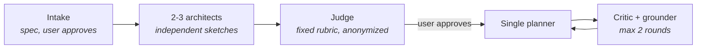

# Planning an Odoo agent with an agent council: what one build measured

*Personal project. The app is public: [odoo-functional-agent](https://github.com/xmglord/odoo-functional-agent).
The planning experiment behind it, council, is still running and not published. It is not a finished method, and
nothing here shows it is better than Claude Code's plan mode. Status as of 2026-10-30.*

## The story in short

I wanted an agent that takes a business requirement and configures Odoo 20 on a demo database. I also wanted to know
whether a multi-agent planning pipeline earns its cost on a build that size. So the app became the test: the same
brief went to plan mode and to the pipeline, the pipeline's plan was built, and every failure during the build went
into a log.

The app shipped. The planning question is still open: the council's plan introduced more defects than it prevented,
it also supplied the verification that found real Odoo 20 behaviour, and plan mode's plan was never built to compare.

## What council is

A planning pipeline for Claude Code, built on one idea: a session is a weak judge of its own plan. One planner writes,
and fresh agents that did not write the plan review it.

The grounder checks technical claims against real documentation and source. Whatever it cannot verify becomes a
mandatory spike instead of a debate.

## Test 1: seeded defects did not discriminate

Two fixtures, with answer keys written before any run: a plan with 10 planted defects and a subtler one with 13.
Three conditions: one generic reviewer, four generic reviewers, four reviewers with assigned lenses (red team, scope,
executability, grounding).

| Fixture | 1 generic | 4 generic | 4 lenses |
|---|---|---|---|
| v1 (10 defects) | 10/10, 10/10 | 10/10, 10/10 | 10/10, 10/10 |
| v2 (13 defects) | 13/13, 13/13 | 13/13, 13/13 | 13/13, 13/13 |

One generic reviewer caught everything, so the test hit its ceiling twice and could not show a benefit for lenses.
On extras, lenses did not beat plain resampling, and on v2 they produced more invalid findings (5 and 6 against 0 and
1). The rule written in advance said lenses had to clearly win, so I removed them. Review became one fresh critic plus
the grounder.

## Test 2: one real app

The brief was identical for both conditions, and seven checks were written before either run.

- **Plans.** An anonymized grader compared them on those checks. The council was ahead on verification: scenario
  assertions, and API facts checked against Odoo 20 source. Asked which plan to execute, the grader picked plan mode
  with the council's assertion format added: "the gap is mostly one of scale". Two of its criticisms of the council
  plan do not hold, but the pick stands as the grader's.
- **A confound.** The two conditions got different intake answers: Enterprise and the Mexican localization were in
  the council's scope only, so part of the scope difference comes from that, not from the method.
- **The build.** All 30 tasks done, from the council's plan. Each failure in the log was then classified against what
  plan mode's plan would have done:

| Class | Count |
|---|---|
| Defects introduced by the council plan (contracts, execution waves, spikes, design choices only it made) | 23 |
| Defects plan mode would also have had | 8 |
| Failures the council plan prevented | 11 |
| Plan hits that only offset its own design | 6 |

Most of the 23 were cheap: underspecified or inconsistent contracts the builder resolved in minutes. Three were not:
a lint task that had to be redesigned, a snapshot of the bot user's permissions that broke a live apply, and a
parallel-safety criterion that ignored shared runtime state. Two of the 11 prevented failures were holes in the
demo-only guard.

## Cost

Weighted token units with assumed ratios (input 1, cache write 2, cache read 0.1, output 5), so these compare stages
of this project and are not prices.

| Stage | Weighted units |
|---|---|
| Plan mode planning | 0.18M |
| Council planning, including spikes and side work | 10.9M |
| Build (session plus its subagents) | 68M |

The council cost about 60 times plan mode, or about 36 times without the spikes. The build cost about 6 times the
council's planning. The example sessions are not in that total: one measured 2.55M, and the transcripts of the other
four were not kept. Whether a better plan lowers the build cost is not measured, because only one condition was built.

## The app

[odoo-functional-agent](https://github.com/xmglord/odoo-functional-agent) is a Claude Code plugin. A requirement
becomes a plan you read and approve, the approved plan is frozen and applied to a local demo database, and functional
scenarios read the results back as evidence. Everything it changes in Odoo goes through one small CLI that refuses
any database it did not create.

Five examples ship with their plans, run reports and screenshots: Sales + CRM, Purchase + Inventory, Accounting,
Mexican localization and Multi-company. Each example's README says what I contributed and where the skill was wrong.

Read-back assertions, role identities and negative tests found real Odoo 20 behaviour: approval thresholds work on
the taxed total, a mandatory analytic plan is enforced only by the Post button and not by the API, a rate comparison
drifted, the SAT rejected a "PUBLICO EN GENERAL" receiver without a global invoice, the Mexican template had a broken
account, and branch users hit a crash in `l10n_mx_edi`. The assertion format came from the council's plan. Plan
mode's prose scenarios were never run, so how many of these they would have found is unknown.

The tooling also grew past the plan: company context, test identities, expected errors and checks on returned files
each came from a gap an example exposed.

## What this does not show

- **One app, one repetition.** No trend can come from it.
- **The grader of the build was not blind.** The same session kept the log and knows both plans.
- **Plan mode was never built.** "Plan mode would have hit it" and "the council prevented it" are judgements, not
  measurements.
- **Scope differed.** Enterprise and the Mexican localization were in the council's scope only.
- **Same-model reviewers.** The fixtures and the reviewers came from the same model family.
- **Costs are incomplete.** Four of the five example sessions were not measured.

## What happens next

The pipeline has not changed since test 2. Next is a bounded comparison: plan mode's plan gets built on the same
edition as the council's, far enough to compare it with the logged build. It will still be one repetition, by an author
who already knows the answers, and this page will report it either way.

## How I used AI

I wrote the requirements, answered intake, approved each plan and ran the example sessions. Claude Code wrote the
code and the plans. The first example needed a functional correction from me, and from the fourth example on I also
reviewed plans with a separate session, whose suggestions changed test plans and one fiscal-data rule. A separate
session kept the failure log, so the builder did not grade itself.
