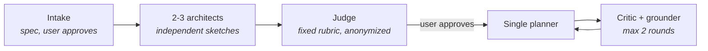

# Planning an Odoo agent with an agent council: what two builds measured

*Personal project. The app is public: [odoo-functional-agent](https://github.com/xmglord/odoo-functional-agent).
The planning experiment behind it is public too: [council](https://github.com/xmglord/council), with its evidence.
Three tests are closed and pipeline v3 is pending. It is not a finished method, and nothing here shows it is better
than Claude Code's plan mode. Status as of 2026-11-02.*

## The story in short

I wanted an agent that takes a business requirement and configures Odoo 20 on a demo database. I also wanted to know
whether a multi-agent planning pipeline earns its cost on a build that size. So the app became the test: the same
brief went to plan mode and to the pipeline, the pipeline's plan was built, and every failure during the build went
into a log. Then plan mode's plan was built too, with the same model and requirements.

The app shipped. Plan mode's plan built nearly the same thing, at about 2.2 times the cost, and did not close cleanly.
Most of that cost was testing, and that testing found gaps the council build shows no sign of checking. The council is
not shown to be better by defect count, and the planning question stays open.

## What council is

A planning pipeline for Claude Code, built on one idea: a session is a weak judge of its own plan. One planner writes,
and fresh agents that did not write the plan review it.

The grounder checks technical claims against real documentation and source. Whatever it cannot verify becomes a
mandatory spike instead of a debate.

## Test 1: seeded defects did not discriminate

Two fixtures, with answer keys written before any run: a plan with 10 planted defects and a subtler one with 13. The
keys are withheld, and the repo publishes their hashes. Three conditions: one generic reviewer, four generic reviewers,
four reviewers with assigned lenses (red team, scope, executability, grounding).

| Fixture | 1 generic | 4 generic | 4 lenses |
|---|---|---|---|
| v1 (10 defects) | 10/10, 10/10 | 10/10, 10/10 | 10/10, 10/10 |
| v2 (13 defects) | 13/13, 13/13 | 13/13, 13/13 | 13/13, 13/13 |

One generic reviewer caught everything, so the test hit its ceiling twice and could not show a benefit for lenses.
On extras, lenses did not beat plain resampling, and on v2 they produced more invalid findings (5 and 6 against 0 and
1). The rule written in advance said lenses had to clearly win, so I removed them. Review became one fresh critic plus
the grounder.

## Test 2: one real app

The brief was identical for both conditions, and seven checks were written before either run.

- **Plans.** An anonymized grader compared them on those checks. The council was ahead on verification: scenario
  assertions, and API facts checked against Odoo 20 source. Asked which plan to execute, the grader picked plan mode
  with the council's assertion format added: "the gap is mostly one of scale". Two of its criticisms of the council
  plan do not hold, but the pick stands as the grader's.
- **A confound.** The two conditions got different intake answers: Enterprise and the Mexican localization were in
  the council's scope only, so part of the scope difference comes from that, not from the method.
- **The build.** All 30 tasks done, from the council's plan. Each failure in the log was then classified against what
  plan mode's plan would have done:

| Class | Count |
|---|---|
| Defects introduced by the council plan (contracts, execution waves, spikes, design choices only it made) | 23 |
| Defects plan mode would also have had | 8 |
| Failures the council plan prevented | 11 |
| Plan hits that only offset its own design | 6 |

Most of the 23 were cheap: underspecified or inconsistent contracts the builder resolved in minutes. Three were not:
a lint task that had to be redesigned, a snapshot of the bot user's permissions that broke a live apply, and a
parallel-safety criterion that ignored shared runtime state. Two of the 11 prevented failures were holes in the
demo-only guard.

## Test 3: building plan mode's plan

Test 2 could only judge what plan mode would have done, so plan mode's plan was built, with a scope amendment matching
the council's: Enterprise and the same five areas, same model, same requirements. Hidden findings are six Odoo 20
behaviours the council build had found, never shown to this build. Defect rows were graded blind.

| | Plan mode | Council |
|---|---|---|
| Cost, full run counted the same way | 202.05M | about 91M (about 12M estimated) |
| Active agent hours, build | 11.9 | 5.3 |
| Hidden findings with evidence | 3, plus 2 unmeasured, 1 could not arise | 5, plus 1 unmeasured |
| Defect rows, the five requirements | 21 | 20 |
| Needs read from the database (49) | 36 met, 12 partial, 1 not met | not read the same way |
| End state | Last requirement with one test failing and one not run | Complete and published |

- **The gap comes from testing.** Plan mode cost half as much up to the first requirement, and its tester alone took
  145.31M, 72% of the total.
- **That testing bought something.** Its 69 regular tests on the last requirement, by browser and by role, exposed
  about nine classes of real gap that the council build shows no sign of checking.
- **Cold cache does not explain the gap.** Removing the excess from resumed sessions gives about 122M against 66M, at
  the point measured and not at the final totals.
- **Defect totals are not comparable.** The council's 72 include 45 from the build stage, and plan mode's log has no
  rows before the first requirement.

## Cost

Weighted token units with assumed ratios (input 1, cache write 2, cache read 0.1, output 5), so these compare stages
of this project and are not prices.

| Stage | Weighted units |
|---|---|
| Plan mode planning | 0.18M |
| Council planning, including spikes and side work | 10.9M |
| Council build (session plus its subagents) | 68M |
| Council full run, including estimated example sessions | about 91M |
| Plan mode full run, test 3 | 202.05M |

The council's planning cost about 60 times plan mode's, or about 36 times without the spikes, and its build cost about
6 times its planning. Planning cost matters little next to execution. With one build of each plan, and most of the
difference in testing, this does not say whether a better plan lowers the build cost.

## The app

[odoo-functional-agent](https://github.com/xmglord/odoo-functional-agent) is a Claude Code plugin. A requirement
becomes a plan you read and approve, the approved plan is frozen and applied to a local demo database, and functional
scenarios read the results back as evidence. Everything it changes in Odoo goes through one small CLI that refuses
any database it did not create.

Five examples ship with their plans, run reports and screenshots: Sales + CRM, Purchase + Inventory, Accounting,
Mexican localization and Multi-company. Each example's README says what I contributed and where the skill was wrong.

Read-back assertions, role identities and negative tests found real Odoo 20 behaviour: approval thresholds work on
the taxed total, a mandatory analytic plan is enforced only by the Post button and not by the API, a rate comparison
drifted, the SAT rejected a "PUBLICO EN GENERAL" receiver without a global invoice, the Mexican template had a broken
account, and branch users hit a crash in `l10n_mx_edi`. The assertion format came from the council's plan. These are
the hidden findings of test 3.

The tooling also grew past the plan: company context, test identities, expected errors and checks on returned files
each came from a gap an example exposed.

## What this does not show

- **One app, one run of each build.** No trend can come from it.
- **The grading has limits.** The grader of test 2's build was not blind. Test 3's defect grader was, but one session
  kept both logs, they differ in depth, and 14 of plan mode's 21 defect classes and 26 of the council's 72 are doubtful.
- **Plan mode was built second.** I already knew the answers, which favours it. It also had no review session on the
  last two requirements, while the council had one on both.
- **The ceiling moved.** Test 3's cost ceiling rose three times, from 80M to 210M, each time after results were visible.
  Results past 180M are the least pre-registered.
- **The builds are not identical.** Plan mode's plan was written for different scope and then amended, and company
  choices differ across three requirements.
- **Test 2's classes stay judgements.** Test 3 built plan mode's plan once. It did not re-measure those rows.
- **Same-model reviewers.** The fixtures and the reviewers came from the same model family.
- **Costs are incomplete.** About 12M of the council's 91M is estimated, and four of its five example sessions were not
  measured.

## What happens next

The pipeline has not changed since test 2. Next is v3, with candidates from both builds to try: simpler contracts,
fresh subagents instead of long-lived ones, and test depth decided on purpose. It then runs on a new large project with
a pre-registered protocol. Until then, the [usage rule](https://github.com/xmglord/council#preliminary-usage-rule) is
preliminary.

## How I used AI

I wrote the requirements, answered intake, approved each plan and ran the example sessions. Claude Code wrote the
code and the plans. The first example needed a functional correction from me, and from the fourth example on I also
reviewed plans with a separate session, whose suggestions changed test plans and one fiscal-data rule. A separate
session kept the failure log, so the builder did not grade itself. In test 3 I approved every correction package, and
each intervention is in the log.
